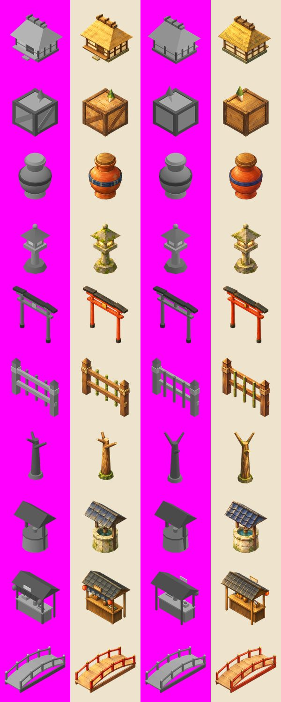

# Rokugan Cozy Village

A small, cosy isometric 3D sandbox set in Rokugan (the feudal-Japan-inspired world of *Legend of the Five Rings*). It plays a bit like a tiny Animal Crossing or Minecraft. You live on a little island village surrounded by the sea, with a river and a pond. You can farm rice, daikon and tea, fish in fresh water and in the sea, forage wild greens, sell your harvest to Hana at her stall, and decorate the village with minka houses, torii gates, stone lanterns, trees and more. The village runs on your local clock, with a daily rhythm of requests. The long-term goal is waking the Seven Fortunes at the quiet shrine; chapter 1 is Ebisu (see [docs/DESIGN.md](docs/DESIGN.md)).

**There is no energy, stamina or fatigue system.** Every action is free and unlimited.

Under the hood, the art comes from a real pipeline:

1. Every prop starts as a grey **blockout** made of three.js primitives.
2. The blockout is rendered from the game's fixed isometric camera.
3. **Codex CLI** repaints each render by hand in one consistent style.
4. The game **projection-maps** those paintings back onto the 3D blockouts.



## Play / deploy

The site is plain static files served from the **repository root**: `index.html`, `style.css`, `src/`, `assets/`, plus a `.nojekyll` file. There is no build step. three.js is pinned at `three@0.170.0` and loaded from unpkg through an import map. All paths are relative, so it works under a GitHub Pages project sub-path such as `/rokugan-cozy-village/`.

* **GitHub Pages:** Settings → Pages → "Deploy from a branch" → `main` / `(root)`.
* **Locally:** run `npm run serve`, then open http://127.0.0.1:8080/rokugan-cozy-village/. Any static server works, but `file://` does not, because ES modules need HTTP.

Progress auto-saves to `localStorage` every 10 seconds, and also when you hide or leave the tab. To start over, open **?** and click "Start a new village".

## Controls

| Action | Keyboard / mouse | Touch |
|---|---|---|
| Walk | WASD / arrow keys, or click a tile | **drag anywhere**: a floating joystick appears under your finger (analog speed) |
| Do the obvious thing with something | click it | **tap** it (see "smart tap" below) |
| Use the tile in front of you | Space / E / Enter | the round context button (shows what it will do: Harvest, Water, Plant, Fish…) |
| Inspect | — | **long-press** (crop growth %, prop names) |
| Select tool / seed | 1–7, or click the hotbar | tap the hotbar; the Seeds slot opens a seed picker when tapped again |
| Build mode | B or 8, or the **Build** button | Build slot in the hotbar |
| Place a prop | click a tile | tap to preview, drag the preview (it floats above your finger), tap it again or **✓ Place** |
| Rotate | R | ⟳ on the build bar, or **Rotate** in the prop menu |
| Move / rotate / store a placed prop | click it with the basket ("pick up") selected | tap it: a menu offers **Move / Rotate / Store** |
| Bag (inventory) | I or 9 | Bag slot in the hotbar |
| Zoom | mouse wheel, or the ＋/－ buttons | **pinch** |
| Look around | — | **two-finger drag** (drifts back to the player when you walk) |
| Reel in a fish | Space or click when the **!** appears | **touch down anywhere** (or the big Reel! button); phones also vibrate on a bite |
| Close panel / leave build mode | Esc | ✕, swipe the sheet away, or ✓ |

**Smart tap / click.** What a tap does depends on what you tapped. The selected tool only matters where it clearly applies.

* Ripe crop: harvest it.
* Dry crop: water it. Already watered: show its growth.
* Empty tilled soil: plant the selected seed, otherwise the last seed you used.
* Water: switch to the rod, walk to the shore and cast.
* Hana or her stall: open the shop.
* The shrine: walk up to it and open the offerings sheet.
* Wild greens: pick them.
* Grass, with the hoe selected: till it.
* Anywhere else: walk there, or to the nearest reachable tile.

Taps made while you're busy are **queued**. Numbered chips mark them, and they run in turn, up to 24. **Swipe** across a field (start the drag on soil or a crop) to harvest, water or plant every tile you pass over.

## Features

* **Island and camera:** a 40×40 tile island. The sea, beaches, cliffs, a river and a pond come from a deterministic generator (`src/game/world.js`). The land is drawn as one soft block: coastlines and banks are filleted in plan view and roll over a rounded top edge into the cliff (`src/render/ground.js`). The camera is a fixed isometric orthographic one (azimuth 45°, elevation 35.264°). It follows the player smoothly and zooms with the mouse wheel, with no free rotation.
* **Player and movement:** a low-poly villager in a straw *kasa* hat with walk, idle and tool-swing animations. Movement collides with props and water.
  * Clicking a tile walks there using A* pathfinding.
  * Clicking a tile with a tool walks next to it and uses the tool.
  * Bridges are walkable, and the player climbs the arch of the deck. Old saves with a bridge that hangs over the water get it nudged by a tile (or back in the bag) on load.
* **Build mode:** a ghost preview with green/red validity tint and footprint squares. Placement snaps to the grid and rotates in 90° steps. Picking a prop up returns it to the inventory.
  * Placeable props: crate, clay pot, stone lantern (*tōrō*), fence, minka house, torii gate, well, arched bridge (four tiles long: bank, two tiles of water, bank), sakura, pine and bamboo.
  * The torii's middle tile stays walkable.
* **Farming:**
  * The hoe tills grass (or sand) into soil. Seeds (rice, daikon, tea) plant on tilled soil.
  * Crops grow through 3 stages in real time, using timestamps, so growth catches up after the tab was closed. Per stage: daikon takes 2 minutes (a snack crop for one session), rice 12 and tea 80 (a check-in crop that regrows).
  * The watering can doubles the speed of the current stage, and wet soil is drawn darker.
  * Harvesting puts the crop in your inventory. Tea bushes regrow after harvest.
* **Fishing:**
  * Face water with the rod and cast. A bobber, line and ripples appear.
  * After a random wait the fish bites: a **!** bubble appears and the bobber dips. Press Space or click within the bite window to catch it. Pressing too early scares the fish; too late and it gets away.
  * Fresh water (river/pond) has ayu and koi. The sea has tai and fugu. Each fish has its own bite window.
  * Once Ebisu wakes, the pier reaches deep water with five more fish: aji, saba (5–11 h), tako (16–21 h), ika (19–5 h) and the rare golden tai.
  * Bait (from Ebisu, then Hana) makes rare fish bite three times as often and bites come sooner. One is used only when you land a fish.
* **Daily rhythm (`src/game/daily.js`, `src/render/daylight.js`):** the sky, lights and lantern glows follow your local time. Each day (from 5:00, seeded by the date) brings three requests from Hana, one item she pays ×1.5 for, two decorations on special and six wild greens to find. The **Today** sheet (the clock pill) shows all of it, plus a "while you were away" summary after a break.
* **The shrine (`src/game/shrine.js`):** the quiet, overgrown shrine across the river wants four small offering bundles. They can be filled a little at a time. Ringing the bell wakes Ebisu: the camera visits the restored shrine and the new pier, and a card lists what changed. Daikoku's stone beside it is the hook for chapter 2.
* **Sound (`src/audio/sound.js`):** procedural Web Audio music (plucked koto-like strings and a flute on Japanese scales), waves, birds and crickets by time of day, and effects for every action. Music and effects can be switched off in **?**.
* **Saves:** versioned saves with migrations (now v3) and a rolling backup slot. **?** can make a backup code to copy, share or save, and restore one in any browser. The game is an installable PWA, works offline after one visit, and asks the browser to keep its storage.
* **Economy:** koku money. At Hana's stall you can sell produce and fish (sell one, sell all, or sell everything) and buy seeds and decorations. Small toast messages appear as feedback.
* **UI:** hotbar with painted icons, bag panel, help card.
* **Mobile:**
  * Gestures: floating joystick, smart tap with an action queue, long-press inspect, pinch zoom and two-finger pan.
  * Picking: picking prefers what's actually under the finger, checking along the view ray. That includes crop and tree billboards, tall props and Hana. Taps snap to nearby ripe crops only when the tapped tile itself does nothing.
  * Camera: framed by the short screen side, about 10 tiles across in portrait.
  * Screen fit: notch safe areas, `100dvh` sizing and `visualViewport` resize handling.
  * HUD: touch targets of at least 44 px, hover styles only on hover-capable devices, and a compact hotbar with a seed picker.
  * Shop and bag open as **bottom sheets** in portrait and **side sheets** in landscape, with swipe-to-close.
  * Buttons respond on touch release, with no click delay, and still work when a slow frame stretches a tap.
  * There's an in-game confirm dialog and a touch-specific help card.
* **Look:** painted props via projection mapping, and instanced billboard vegetation with vertex-shader sway. Also:
  * a painted-tile ground shader with noisy, brush-like borders between terrain types
  * an animated sea with shallows and foam
  * a warm sun with soft PCF shadows plus a hemisphere light
  * drifting sakura petals and small particle puffs
  * a full-screen "paper" pass: ink edges from depth, paper fibre and grain, a warm grade and a vignette

## Art pipeline

Every step is a real script in this repo:

* `pipeline/render.mjs` → `pipeline/out/renders/`
* `pipeline/paint.mjs` → `pipeline/out/painted_raw/` and `pipeline/out/log/`
* `pipeline/postprocess.py` → `assets/painted/`, `pipeline/out/manifest.json` and `contact_sheet.jpg`

```bash
npm install                 # playwright-core (uses system Chrome, no browser download) + three (for node-side imports)
npm run pipeline:render     # step 2: blockout renders + camera JSON + sheet guides
npm run pipeline:paint      # step 3: Codex paints (idempotent; --force to redo, --only minka_a45,vegetation)
npm run pipeline:post       # step 3b: align / key / downscale -> assets/painted
npm run pipeline            # all three
npm test                    # desktop smoke test + mobile touch test
```

Requirements:

* Node 20+
* Chrome at `/usr/bin/google-chrome`, or set `CHROME_PATH`
* Codex CLI at `~/.local/bin/codex`, or set `CODEX_BIN`
* Python 3 with Pillow and numpy

### 1. Blockouts (`src/assets/blockouts.js`)

Each prop is defined once as data: boxes, cylinders, cones, spheres, gable prisms and hipped roofs. Each primitive is tagged with a material "part" from the shared palette (`src/assets/palette.js`). `buildBlockoutGeometry()` merges a blockout into one asset-space geometry, with a vertex colour for each part. The **game and the pipeline both import this same module.**

### 2. Render (`pipeline/render.mjs` + `pipeline/render.html` / `render-page.js`)

Node starts a tiny static server and launches the system Chrome through playwright-core. It uses the flags `--no-sandbox --use-angle=swiftshader --enable-unsafe-swiftshader --ignore-gpu-blocklist`. The pipeline page then renders every blockout with the **game's isometric camera** at azimuths **45° and 225°**, using an orthographic frustum fitted to the asset (`src/render/paintCamera.js`). Each render writes these 1024² passes:

* `*_grey.png`: neutral shaded render on a #FF00FF background. This is what Codex repaints.
* `*_outline.png`: ink lines from depth and normal discontinuities. Also sent to Codex.
* `*_normal.png`: view-space normals.
* `*_depth.png`: depth packed into R and G (16 bit). B = 0 marks the background.
* `*_mask.png`: alpha mask.
* `*_color.png`: flat palette colours, used by the procedural fallback.
* `*_camera.json`: the exact view, projection and view-projection matrices, plus view direction, frustum and bounds.

The page also draws a **guide image** for each sprite sheet: a grid layout with rough coloured canvas sketches in each cell.

### 3. Paint with Codex (`pipeline/paint.mjs`, prompts in `pipeline/jobs.mjs`)

Each asset and angle gets one non-interactive Codex call:

```
codex exec --skip-git-repo-check -s workspace-write -C pipeline/out/painted_raw -i <grey.png> -i <outline.png>   (prompt on stdin)
```

The prompt goes through stdin because `-i` is variadic and would swallow a trailing prompt argument. The script runs up to 4 calls in parallel, with 3 attempts per job and an 8-minute timeout. It skips outputs that already exist. If Codex generates an image but forgets to copy it, the script recovers it from `~/.codex/generated_images/<session>/`.

Every call is appended to `pipeline/out/log/codex_calls.jsonl`. A full transcript of each attempt, including the prompt, is saved as `pipeline/out/log/<job>_attemptN.txt`.

All calls share one **style prompt**: hand-painted cosy Rokugan, soft gouache and watercolor brushwork, Ghibli-like warmth, and a palette of vermilion, indigo, moss green, cream and soft gold. The prompt also tells Codex to keep the exact silhouette, framing and camera, and to paint on a flat #FF00FF background.

Codex also paints five sheets from the guide images:

* **vegetation**: grass ×2, flowers ×2, bamboo, bush, reeds, fern
* **crops**: rice, daikon and tea × 3 growth stages
* **canopy**: sakura ×2 and pine ×2 foliage clumps
* **tiles**: grass, sand, path, tilled soil, water, cliff
* **icons**: tools, seeds, produce, 4 fish, a koku coin and a basket

### 3b. Post-process (`pipeline/postprocess.py`)

For each painted asset and angle, the script:

1. Keys out the magenta.
2. Fits the painting's bounding box to the render mask's bounding box. It keeps the raw framing instead if that already overlaps the mask better, and records IoU before and after.
3. Fills any holes inside the mask, and bleeds colour outside it, with a push-pull fill.
4. Downscales to 512² WebP.
5. Min-pools the packed depth to 512², so occluders stay conservative.
6. Cuts a 128² RGBA icon.

If a painting is missing, or its silhouette IoU is below 0.55, a **procedural brushy texture** is made instead from the colour and outline passes, and the manifest flags it as procedural.

For sheets, the script keys the magenta and finds connected components across the whole sheet, so sprites that overflow their cell stay whole. It then re-anchors each sprite (bottom-centre, or centred for icons) and packs it into an atlas. Codex is asked for seamless tile textures, and the script also cross-fades each tile with a half-offset copy to make sure it tiles.

Outputs:

* `assets/painted/manifest.json`: the game-facing file, with cameras, textures and atlas UVs.
* `pipeline/out/manifest.json`: per asset and angle, whether Codex painted it, the alignment stats and the file paths, plus Codex call statistics.

### 4. Projection (`src/render/materials.js`)

Props use a `MeshLambertMaterial` patched with `onBeforeCompile`:

* Each fragment's **asset-space** position goes through each painting camera's stored view-projection matrix to get a UV.
* That painting is weighted by `smoothstep(dot(normal, -viewDir))`, times a **depth-visibility test** against that camera's stored depth pass. The depth test stops self-occluded parts from picking up the occluder's paint.
* Because the projection works in asset space, props can be moved and rotated freely. With two opposite angles (45° and 225°), all four sides of a prop are covered at any 90° rotation.
* Faces that neither painting camera sees fall back to the part's palette colour with brush noise.
* Scene lighting and shadows are only partly blended in (`uLightMix`), because the paintings already contain light.

### 5. Vegetation (`src/render/vegetation.js`)

Instanced, camera-facing quads in three layers: grass and flowers, crops, and tree canopies. They sample the painted atlases with alpha-tested cut-outs and sway gently in the vertex shader. Trees are a painted trunk mesh plus three canopy billboards. Bamboo is billboard-only. Blob shadows sit under trees.

### 6. Unify (`src/render/postfx.js`, `src/render/ground.js`)

The whole scene shares one palette, a warm `HemisphereLight` plus a directional sun with soft shadows, and the painted ground tiles. A full-screen pass then adds ink edges from depth, paper fibre and grain, a warm grade and a vignette.

## What Codex painted

The pipeline log (`pipeline/out/manifest.json`, `pipeline/out/log/codex_calls.jsonl`) holds **34 Codex image calls: 34 succeeded, 0 failed**, with no retries and no procedural fallbacks: the original 25, plus 9 for the shrine chapter.

| Asset | Angles | Painted by |
|---|---|---|
| minka, crate, pot, toro (stone lantern), torii, fence, trunk (sakura/pine), well, stall, bridge | 45°, 225° | **Codex** (20 calls) |
| vegetation sheet (grass, flowers, bamboo, bush, reeds, fern) | — | **Codex** |
| crops sheet (rice/daikon/tea × 3 stages) | — | **Codex** |
| canopy sheet (sakura/pine clumps) | — | **Codex** |
| tiles (grass, sand, path, soil, water, cliff) | — | **Codex** |
| icons (tools, seeds, produce, fish, koku, basket) | — | **Codex** |
| shrine_old (overgrown), shrine (restored), pier, stone (Daikoku's sleeping stone) | 45°, 225° | **Codex** (8 calls) |
| icons2 (aji, saba, ika, tako, golden tai, bait, shrine bell, Ebisu) | — | **Codex** |

**Not painted by Codex (procedural):**

* the player and merchant characters (brush-noise Lambert shader)
* the hotbar "pick up" and "build" buttons, which reuse painted icons
* palette fallback colours on faces neither paint camera sees
* the water shader, particles and paper-grain texture

The procedural brush fallback and the canvas guide sketches exist in the pipeline, but this run did not need them.

> Note: the first 3 invocations during development exited instantly with a CLI usage error. The prompt was passed after the variadic `-i` flag, so the call never reached the model. The fix was to pipe the prompt via stdin. Those log lines were cleared before the real run, so the log only contains the 25 real calls.

## Tests

`npm test` runs both suites; `npm run test:desktop` / `npm run test:mobile` run one.

**Mobile (`tests/mobile.mjs`).** This drives a 390×844 portrait phone and an 844×390 landscape phone with raw CDP touch events (`Input.dispatchTouchEvent`). It checks:

* the touch help card, short-side camera framing, and hotbar slots that are at least 44 px and on screen
* drag-to-move: the joystick appears, and the player moves in the drag direction
* tap-to-harvest on a crop billboard
* two taps queued while busy and run in turn, with numbered chips
* tap to plant, and long-press to inspect
* tap water: walk to the shore, auto-select the rod, and reel on touch-down
* pinch zoom and two-finger pan (which must not walk)
* build mode: preview, drag the preview, ✓ to place, then the prop menu's Rotate and Store
* a field swipe plants a row, and the clock pill opens Today
* tapping the shrine walks up to it and opens the offerings sheet; an offering made by thumb
* tapping Hana opens a bottom sheet in portrait and a side sheet in landscape; sell all and close
* the in-game confirm dialog

It also fails on any console error. Screenshots go to `/workspace/screens/mobile-*.png`.

**Desktop (`tests/smoke.mjs`):**

`tests/smoke.mjs` serves the repo under `/rokugan-cozy-village/` and drives headless Chrome (SwiftShader) with **real keyboard and mouse input**. It covers:

* new game and welcome card
* WASD walking, and click-to-move with pathfinding
* build mode: select a lantern, rotate it, place it with the mouse, ghost preview of a minka, pick the lantern back up
* tilling a grass tile by clicking it with the hoe, planting rice with Space, watering
* harvesting a ripe daikon by clicking it
* casting at the nearest water with the rod, waiting for the bite and pressing Space to catch the fish
* selling at the shop
* a mouse sweep across a field, and a time skip that ripens rice
* claiming one of Hana's requests from the Today sheet, and a day rollover with the "welcome back" card
* the shrine chapter: click the shrine, partial and complete offerings, ring the bell, the wake card, the pier and bait, standing on the pier deck, and which fish bite by hour and place
* a save v3 → reload round trip, a backup code → restore round trip, and an old v1 save migrating (crop growth and landmarks)
* loading offline from the service worker

It also fails on any console error, page error, failed request or HTTP 4xx/5xx. Screenshots are written to `/workspace/screens/` (`01-village.png`, `02-build.png`, `03-farm-fish.png`, plus `04-catch.png`); you can change the folder with `SCREENS_DIR`.

## Project layout

```
index.html, style.css      game page (deploy root)
src/main.js                renderer, camera, lights, input, loop
src/game/                  world, props/build, game logic, data, UI, pathfinding
src/render/                projection materials, ground/water, billboards, post FX, characters, particles
src/assets/                blockouts (shared), palette, sprite-sheet specs
assets/painted/            committed pipeline output (WebP paintings, packed depth, atlases, tiles, icons, manifest) ~2.5 MB
pipeline/                  render / paint / post-process scripts; out/ has manifest, Codex logs, contact sheet
tests/smoke.mjs            end-to-end desktop smoke test (keyboard + mouse)
tests/mobile.mjs           end-to-end touch test (portrait + landscape phones, CDP touch events)
tools/serve.mjs            zero-dependency static server (sub-path aware)
```

## Known gaps

* Only two paint angles per asset. Faces seen edge-on from both, such as diagonal faces of round objects, show more of the palette fallback and stretched paint.
* The shading baked into the paintings doesn't change when a prop is rotated, so its lit side doesn't always match the sun.
* The characters are procedural, not painted, and no villagers wander around yet (Phase 4).
* Only chapter 1 of the shrine exists; Daikoku's stone is a teaser.
* Placing a prop on top of decorative grass removes the grass. Tilled soil can't be turned back into grass.
* Mobile:
  * Only tested with Chrome's touch emulation, not on a physical iPhone or Android phone.
  * Vibration works on Android only; iOS Safari has no `navigator.vibrate`.
  * There are no settings for joystick size or sensitivity.
  * Rendering was left as is (no pixel-ratio or shadow tuning for phones).
* three.js comes from the unpkg CDN, so the very first load needs internet. After that the service worker serves everything offline.
* The full pipeline needs Codex CLI with image generation. The committed `assets/painted/` lets the site run without it.
